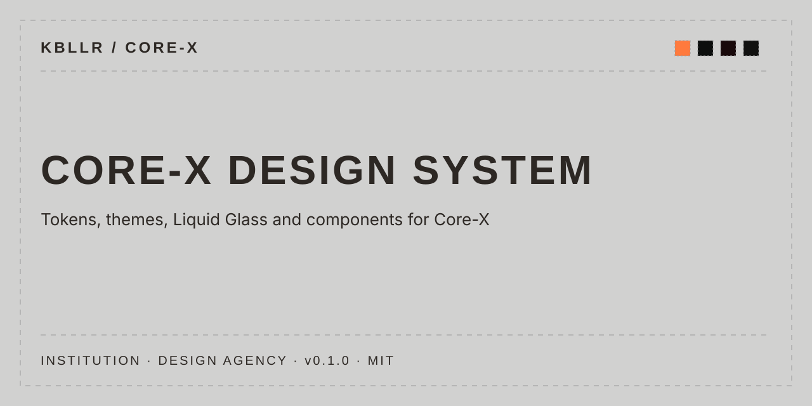
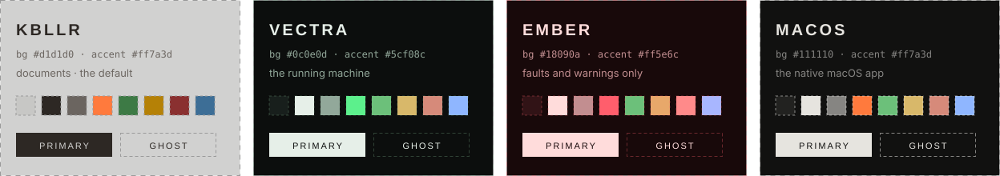
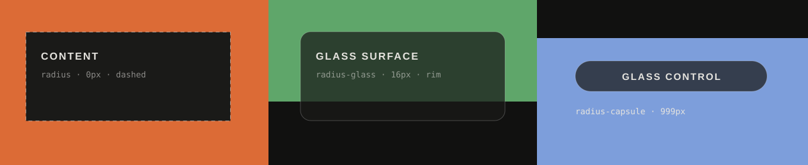

# Core-X Design System

   

One visual language for the Core-X ecosystem: the web shell, the houses and the native macOS app. Warm monochrome, dashed lines, square corners, three typefaces.

**See it live: <https://core-x-design-system.vercel.app>** · Full rules: [GUIDE.md](GUIDE.md)

## Four themes

A theme is a context, not a preference. Set it with `data-theme` on any element.



## The shape rule

Content is square and dashed. Glass is the one rounded layer, and it floats above content.



## Use it on the web

```html
<link rel="stylesheet" href="tokens.css">
<html data-theme="kbllr">
```

```css
.panel {
  background: var(--bg-surface);
  border: 1px dashed var(--border);   /* the dashed line is the brand */
  border-radius: var(--radius);       /* 0: content never rounds */
  padding: var(--space-5);
  color: var(--fg1);
}
.panel h2 {
  font-family: var(--font-heading);   /* Chakra Petch, always uppercase */
  text-transform: uppercase;
  letter-spacing: 0.1em;
}
.panel .id { font-family: var(--font-mono); }  /* Fira Code for IDs and values */
```

## Use it in SwiftUI

```swift
import CoreXDesign

Text("CORE-X").foregroundStyle(CXTheme.macos.color(.fg1))

Button("Send") {}.cxGlassButton(prominent: true)  // capsule glass; one per view
sidebar.cxGlass()                                  // 16pt glass surface
CXGlassGroup { toolbarButtons }                    // never glass on glass
```

`CoreXDesign` is a Swift package generated from these tokens; it lives in the Core-X Chat app (`Packages/CoreXDesign`) and is added by path. Liquid Glass needs macOS 26; the same calls fall back to a material from macOS 14. Reference: [swift/CoreXGlass.swift.txt](swift/CoreXGlass.swift.txt).

## Use it with agents

[skills/core-x-native/SKILL.md](skills/core-x-native/SKILL.md) gives a coding agent the rules for the native app. It is installed in Core-X as the `core-x-native` skill.

## What is in here

| Path | What |
|---|---|
| [`tokens.json`](tokens.json) | Every value: 77 colours in 4 themes, type, spacing, radius, shadow, glass. The source of truth. |
| [`tokens.css`](tokens.css) | The same tokens as CSS custom properties. |
| [`components/`](components/) | 33 components, each with a README and a live preview. |
| [`swift/`](swift/) | The SwiftUI glass reference. |
| [`skills/`](skills/) | The agent skill. |
| [`GUIDE.md`](GUIDE.md) | The full guide: content, visual foundations, motion, materials, ecosystem palette. |
| [`index.html`](index.html) | The live site. |

## Site

`index.html` is served at <https://core-x-design-system.vercel.app> from Vercel, which redeploys on every merge to `main`; the repository stays private. Everything in the repository root is publicly reachable, so do not commit anything here that must stay private.

- No build step: the page reads `tokens.json` and `tokens.css` directly.
- After changing a component preview, run `python3 tools/build-site-index.py`.
- After changing tokens, run `python3 tools/build-readme-art.py` to redraw these README images.
- Both scripts take `--check`. To view the site locally, run `python3 -m http.server` here.

## License

[MIT](LICENSE) · KBLLR
